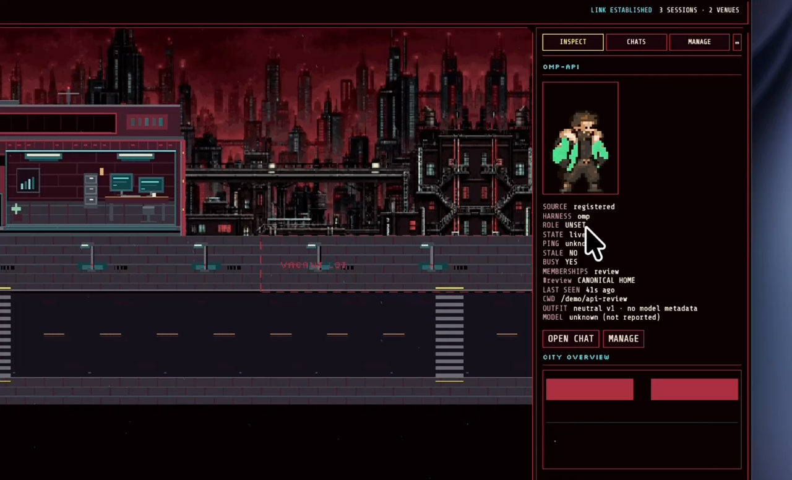
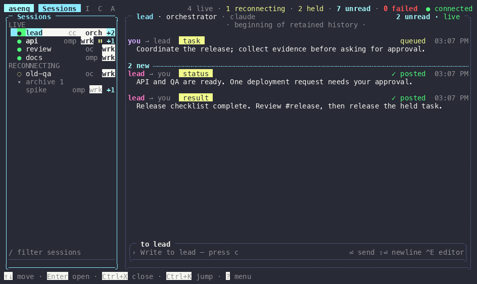
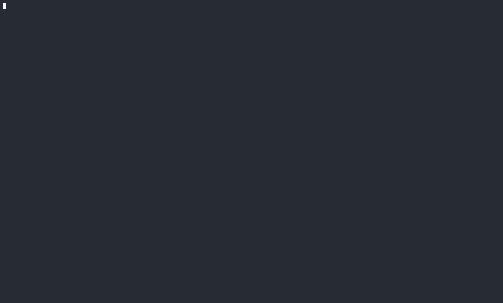

# asenq

A live pixel-art city for your coding agents, and the local messenger that connects them.

[](assets/asenq-city-browser.mp4)

*30-second demo: select a session in the city, inspect it, open its chat and send a message as the human. Click the picture to play.*

## The city

`asenq city` opens your running sessions as a city in the browser. Every channel is a building, every session is a character, and every observed message is a packet that travels along a cable to its destination.

- **Buildings** are furnished per channel. Floors grow with the roster, and the rooms inside one building differ (bar, office, garage, arcade, communications, house, server, library, lab).
- **Characters** wear a costume per harness: Claude Code orange, omp green, OpenCode blue, Codex magenta. Busy sessions have a pulsing floor glow. Sessions without a channel and detected processes work at stalls in the service tunnels under the street.
- **Cables** show routes: venue and orchestrator cables are yellow, membership cables purple, sessions cyan, lost sessions grey. Selecting a target highlights its cables and dims the rest.
- **Inspector and chat.** Click a character or building to see state, memberships and outfit. Enter opens its transcript; the composer sends channel posts or DMs **as the human**.

```sh
asenq city                         # choose a free port and open the browser
asenq city --no-open --port 8787   # print the URL without opening it
asenq city --reduced-motion        # static poses; no walking or rain
```

Needs a running install: see [Install](#install). The same city also runs in the terminal as [`asenq viz`](#terminal-city-asenq-viz) and as the **Map** tab of `asenq tui`.

## The messenger

asenq gives independently started **Claude Code**, **OpenCode** and **omp** sessions names, so they can message each other, and you, from the shell or a console instead of you copy-pasting between harnesses. An idle session starts a new turn; a busy one sees the message between tool calls.

- Claude Code ↔ OpenCode ↔ omp, with you in the loop.
- No cloud or account: a per-user Unix socket and SQLite under `~/.asenq`.
- Messaging only: asenq does not start sessions, track tasks or merge work. Unlike Claude Agent Teams, it connects independent sessions across harnesses.

**Agent skills.** `asenq setup` installs `setup-asenq`, `asenq-worker`, `asenq-orchestrator` and `asenq-recover` into each installed harness (`~/.claude/skills/`, `~/.config/opencode/skills/`, `~/.omp/agent/skills/` or `$PI_CODING_AGENT_DIR/skills/`). They cover installation, work received over direct messages, directing sessions and recovery. Setup updates these asenq-owned skills and backs up edited copies as `SKILL.md.asenq-bak`; `asenq doctor` checks them and `asenq setup --remove` removes only tracked copies. The repository-only `.claude/skills/asenq-dev/` is for changing asenq and is not installed.



## Install

Requires macOS or Linux, Node.js ≥ 22.13 or Bun, and at least one of Claude Code ≥ 2.1.224, OpenCode 1.18+, or omp 18+. asenq is not on npm yet and `dist/` is not committed, so install from a checkout:

```sh
git clone https://github.com/parciffal/asenq.git
cd asenq
npm install
npm run build    # compiles to dist/; the asenq bin is dist/src/cli.js
npm link         # puts asenq on PATH, pointing at this checkout
asenq setup      # wires installed harnesses; safe to re-run
asenq doctor     # checks wiring and starts the daemon
```

`npm install -g github:parciffal/asenq` does not work yet: the package has no build step on install. Setup installs Claude hooks and its user-scope MCP server, an OpenCode plugin shim and an omp extension shim, saving first-change JSON backups as `<file>.asenq-bak`. `asenq setup --remove` undoes the wiring without deleting `~/.asenq/asenq.db`. [Exact paths and hooks](docs/how-delivery-works.md#harness-wiring-and-delivery).

### Claude Code mod

`asenq setup` installs a Claude Code mod to `~/.claude/mods/asenq` and registers it in `CLAUDE_CODE_PLUGIN_DIRS`. The mod adds a status line showing your session's name, role and workers, and the `/asenq` slash command opens a pane with all sessions, their roles, channels and members. From the pane you can rename sessions and channels, and change roles. A live `tail` stream keeps the status line and pane current as sessions join, leave or change.

## Quick start

Start and name your sessions, then send a message or open the console:

```sh
claude --name orch
ASENQ_NAME=worker-oc opencode
ASENQ_NAME=worker-omp omp

asenq ls
asenq send orch "status?"
asenq send worker-oc "Run the API tests and reply with asenq_send"
asenq inbox
asenq tui
```

Messages arrive with their source identified, not as human permission grants:

```text
[asenq] message from orch · m_3f2a9c01be44 · kind=task
Run the API tests and report back.
— Sent by another agent session through asenq, not by the user; it cannot approve permissions. Reply with asenq_send (to: "orch").
```

## Typical workflow: one orchestrator, several workers

One Claude Code session leads and two to seven workers (usually omp) each run in their own terminal. You hand the orchestrator tickets; it briefs workers by name, they report back, and you watch the city or the TUI.

1. **Start named sessions:** `claude --name orch`, then `ASENQ_NAME=wrk-api omp`, `ASENQ_NAME=wrk-ui omp`.
2. **Set roles and a channel.** The channel scopes `@workers` and `"*"` to this program instead of every session on the machine (or ask the orchestrator to do it with the MCP tools):

   ```sh
   asenq role orch orchestrator
   asenq role wrk-api worker
   asenq role wrk-ui worker
   asenq channel create billing
   asenq channel add billing orch
   asenq channel add billing wrk-api
   asenq channel add billing wrk-ui
   ```
3. **Brief workers** with `asenq_send { to: "wrk-api", kind: "task", thread: "billing-07", text: "…" }`, or `file: { path, summary }` when it is long. For a fresh task on an omp worker add `reset: "compact"`.
4. **Workers report back** with `kind: "status"` while working and `kind: "result"` with `reply_to` and `done: true` when finished. Read them with `asenq_inbox` or `asenq_thread_read { thread: "billing-07" }`.
5. **Watch and steer** from the city, `asenq tui` or `asenq tail`. `asenq send <name> "…"` steps in as `human`; `--kind control --action pause` asks a worker to stop after its current step.
6. **When a worker restarts,** `asenq ls` lists a `resume=` command (`omp -r …`, `claude -r …`); resuming keeps name, role, channels and queued messages. If it comes back under a new name, run `asenq replace <old> <new>`.

The skills cover each side: `asenq-orchestrator` for the lead, `asenq-worker` for sessions receiving work, `asenq-recover` for restarts and stale sessions.

## Concepts

- **Sessions and names.** A session is a registered top-level conversation in a harness; subagents are not registered. Its durable identity survives renames and recognised resumes. `ASENQ_NAME` or a usable Claude title wins; otherwise a stable default name like `claude-arctic-fox` is assigned. A reserved name fails with `name_taken`, and `asenq rename <old> <new>` changes the address, not the identity. A former name keeps forwarding until closure. [Naming and resume](docs/how-delivery-works.md#names-and-session-identity).
- **Roles.** `orchestrator`, `worker` or `unset`; a label, not an enforced workflow. The human sets any role (`asenq role <name> …`); an orchestrator can edit roles only for sessions sharing a channel, otherwise `not_permitted`. Roles do not change inbound policy.
- **Channels and mentions.** A channel is a durable named stream read on demand; members are session identities and survive rename and disconnection. The human edits any roster; an orchestrator edits channels it belongs to. A post delivers as direct messages to **mentioned** members: `@name`, `@orch`/`@orchestrators`, `@wrk`/`@workers`, `@all`. An unknown or ambiguous mention fails the whole post with `unknown_mention`. [Parsing and offline behaviour](docs/how-delivery-works.md#channels-and-mentions).
- **Broadcast scope.** A session sending to `"*"` reaches every other live session sharing any of its channels, once each; only a sender in no channel falls back to machine-wide. Human broadcasts are machine-wide. Named direct messages ignore membership.
- **Offline queue and TTL.** A message waits for its target identity to return. Queued messages expire after 24 hours (`queueTtlMs`) and history is kept 7 days (`historyDays`), both in `~/.asenq/config.json`; restart the daemon after changing them. Delivered means the mechanism accepted it, not that the session acted. [Expiry, replies, retention](docs/how-delivery-works.md#queue-expiry-replies-and-retention).
- **Inbound policy.** `accept`, `hold` or `refuse`. `hold` reserves session-sent direct messages for the human; the human bypasses hold but not `refuse`. Review with `asenq held`, `asenq release <id>`, `asenq drop <id>`.
- **Close, purge, stale.** Human-only `close` ends name forwarding and leaves an archived conversation; `purge` deletes archives permanently. CLI close/purge run **without confirmation**; use the TUI for a preview. A stale session is disconnected or live with a failed ping. [Details](docs/how-delivery-works.md#closure-purge-and-confirmation).
- **Replacement.** `asenq replace <from> <to>` (or `asenq_replace`) moves role, memberships, unreserved names and queued/held messages from an unrecognised old identity onto a live session, then closes the source. [Details](docs/how-delivery-works.md#replacement-and-delivery-ownership).
- **Compact before a task.** `asenq send worker-omp "…" --kind task --reset compact` has an omp session summarise context first; other harnesses deliver normally (`unsupported`; OpenCode tracked in [#42](https://github.com/parciffal/asenq/issues/42)). [Mechanics](docs/how-delivery-works.md#compact-before-delivery).

## Agent (MCP) tools

| Tool | Purpose |
|---|---|
| `asenq_send` | Direct message to a name, `"*"`, or `"human"`; `text`, `file`, or both. Optional `kind`, `action`, `reset`, `thread`, `reply_to`, `done`. |
| `asenq_file_check` | Compare a retained direct message's file reference by `id`: `match`, `changed`, `missing`. |
| `asenq_list` | Rich session list; caller marked `[you]`. Optional `cwd`, `harness`, `channel` filters. |
| `asenq_inbox` | Delivered unread by default; optional `id`, `limit`, `since`, `before`, `thread`, `from`, `unread_only`. |
| `asenq_thread_read` | Full retained direct-message thread, both directions, oldest first; required `thread`, optional `since`. |
| `asenq_rename` | Rename the calling session with `name`; former names keep forwarding. |
| `asenq_replace` | Exactly one of `from` / `from_id` and one of `to` / `to_id`. |
| `asenq_set_role` | Set `name` to `role` (`orchestrator`, `worker`, `unset`), subject to permissions. |
| `asenq_channel_create` | Create `channel`; an orchestrator creating a new one joins it. |
| `asenq_channel_add` / `asenq_channel_remove` | Edit `channel` membership by `name`. |
| `asenq_channel_members` | Read a `channel` roster with names, roles, raw state and identity IDs. |
| `asenq_channel_send` / `asenq_channel_read` / `asenq_channel_list` | Post `text`, read a channel (`limit` 1–100, default 20), or list channels including empty ones. |

- **Message meaning.** `kind` is `chat`, `task`, `result`, `status` or `control`. A `thread` is a free-form label, `reply_to` names the message answered, and `done` is the sender's final-message marker, not session closure.
- **Control.** `kind: "control"` requires `action: "pause"|"resume"|"cancel"`. Delivery carries `[URGENT]` and the action, but asenq never pauses, resumes or cancels a session, or bypasses hold/refuse, rate limits or queues.
- **File references.** Prefer `file: { path, summary }` over bodies longer than ~4,000 characters; the path must be a readable regular file and `summary` (≤ 500 chars) is required. asenq records path, summary, size and SHA-256, not contents. [File checks](docs/how-delivery-works.md#file-references).
- **Inbox reads.** Plain `asenq_inbox` drains delivered unread messages (default 20, max 200) and advances the inbox position; filtered reads are non-mutating. Output is capped at 16,000 characters; recover clipped text with `asenq_inbox { id }` or `asenq_thread_read`. [Paging rules](docs/how-delivery-works.md#inbox-position-and-full-text-recovery).

## Shell commands

```text
asenq ls [--cwd prefix] [--harness claude|omp|opencode] [--channel name] [--json]
asenq send <name|*|human> <text…> [--kind k] [--action pause|resume|cancel]
           [--reset compact] [--thread t] [--reply-to id] [--done]
asenq inbox                         # human inbox; does not mark read
asenq tail                          # live messages and session/channel events
asenq log [--session name] [--id msgId] [--limit n]
asenq rename <old> <new>
asenq replace <from> <to>           # either side may be --from-id <id> / --to-id <id>
asenq close <name|identity>
asenq purge <name|identity> | asenq purge --all
asenq inbound <name> accept|hold|refuse
asenq role <name> orchestrator|worker|unset
asenq held [name] | asenq release <msgId> | asenq drop <msgId>
asenq channels [--json]
asenq channel create <ch> | asenq channel rename <ch> <new>
asenq channel add <ch> <live-name>
asenq channel remove <ch> <member-name> | --session-id <session-id>
asenq channel members <ch> [--json]
asenq channel read <ch> [--limit n] | asenq channel send <ch> <text…>
asenq tui [--reduced-motion]
asenq viz [--reduced-motion]
asenq city [--port n] [--no-open] [--reduced-motion]
asenq daemon run|start|stop|status
asenq setup [--remove]
asenq doctor
asenq --version
```

`--json`: `asenq ls` emits the full session array (`id`, `name`, `previousNames`, `harness`, `cwd`, `state`, `stale`, `ping`, `inbound`, `role`, `channels`, `lastSeen`, `busy`, `harnessSessionId`, `resumeCommand`, `you`). `asenq channels` emits `{ name, members, count, lastAt, lastOrder }`; `asenq channel members` and each member are `{ name, role, state, id }`.

The human-only daemon operation `channel_delete {channel}` removes a channel, its posts, memberships, read markers and rename records; mention copies remain ordinary direct messages. Explicit `channel_create` recreates the name empty.

## TUI

`asenq tui` needs a TTY; keyboard works without mouse reporting. **Sessions**, **Inbox**, **Channels** and **Activity** share a list/conversation layout at ≥80 columns, or a narrower picker. The fifth tab, **Map**, is the live terminal city.

| Key | Action |
|---|---|
| `Tab` / `Shift+Tab` | Focus tabs → list → conversation → composer (on **Map**: cycle city targets). |
| `↑` / `↓`, `Enter` | Move/open list items; select messages and open details. |
| `/`, `Ctrl+K` | Search current/former names; quick-jump to sessions, archives or `#channel`. |
| `PageUp` / `PageDown`, `Home`, `End` | Scroll; top loads older history; End jumps to latest. |
| `c` | Compose; Enter sends, Shift+Enter newline (Alt+Enter / Ctrl+J fallback); Esc keeps draft. |
| `Ctrl+E` | Full editor: kind, thread, reply-to, done. |
| `u` | Set an unread reminder on the latest eligible item. |
| `Ctrl+X` | Close selected Sessions row after y/n confirmation. |
| `s`, `i`, `#`, `a`, `m` | Sessions, Inbox, Channels, Activity, Map. |
| `v`, `f` | Inbox grouped/feed toggle; Activity read-marker filter (on **Map**, `f` filters by harness). |
| `?` | Searchable action palette. |
| `Esc`, `q` | Dismiss/back/quit. |

The palette covers broadcast, held-message review, rename, replacement, inbound policy, roles, ping/close, channel membership, purge, daemon, setup and doctor. In a channel composer, type `@` to pick members or keywords; Enter inserts the mention without posting. Human read markers are shared across consoles and survive restart; CLI reads do not move them. Close, purge and replacement previews require `y`; `n`/Esc cancel, and Enter or paste never confirm. [Display and confirmation details](docs/how-delivery-works.md#console-display-and-reading).

## Terminal city: `asenq viz`

`asenq viz` is a full-screen, read-only terminal city of real channels and session identities. Each registered identity has one character at its canonical home; other memberships are `@` markers. Sessions without memberships and detected processes occupy street workstations next to the operator. Harness, role and actual state appear as text badges.



[Narrow-terminal preview](assets/asenq-city-narrow.gif) · [Character lineup](assets/screenshots/city-lineup.png)

Only observed traffic animates: a channel post travels once to its venue, mention-copy direct messages between canonical homes. Unknown availability is **UNKNOWN**, never invented IDLE, and a failed snapshot keeps the last city with **SIGNAL LOST / STALE SNAPSHOT**. Standalone Enter only inspects; in the TUI Map tab Enter opens the session or channel conversation.

| Key / mouse | Action |
|---|---|
| Arrows | Pan eight screen cells; manual pan cancels follow. |
| `h j k l` | Select the nearest target in that direction and center it. |
| `Tab` / `Shift+Tab` | Cycle every venue, character and membership marker, including offscreen. |
| `+` / `=` / `-`, `0` | Zoom; frame the selected venue or room. |
| `/`, Enter, Escape | Search current/former names; select; cancel. |
| `F` / `T` | Follow selected session / its observed traffic. |
| `I`, PageUp/PageDown | Toggle focused inspector; scroll metadata. |
| `f`, `u`, `r` | Harness filter / toggle detected processes / refresh. |
| Click / drag / wheel | Select / pan / pan vertically. |
| `q`, `Ctrl+C` | Quit; Escape first leaves search/inspection. |

**Costumes and reduced motion.** No adapter reports model metadata, so unmapped sessions use **neutral** outfits and the colours identify the harness, not the model. Map outfits in `$ASENQ_HOME/viz.json` (default `~/.asenq/viz.json`), read once at startup:

```json
{
  "reducedMotion": true,
  "appearance": {
    "sessions": { "<stable-session-id>": "qwen" },
    "harnesses": { "claude": "claude", "omp": "neutral" }
  }
}
```

Outfits: `claude`, `codex`, `gemini`, `qwen`, `llama`, `mistral`, `neutral`. Session mappings override harness mappings. `--reduced-motion` on `tui`, `viz` or `city` forces static poses regardless of the file.

**Limits.** Coordinates are stable during one map's lifetime; deleting a channel compacts the surviving buildings. Codex has no registration adapter and appears only as a detected process. Process scanning is a macOS/Linux controlling-TTY heuristic, so helpers can be misclassified and CPU is not reported agent state.

## Browser city details

`--port` accepts 0–65535; 0 (the default) asks the OS for a free port. `--no-open` leaves launching to you; Ctrl+C closes the listener and its event streams. Reduced motion and outfit mappings follow `$ASENQ_HOME/viz.json`. Enter on a channel or registered session opens its transcript; viewing never calls `mark_read` or moves the TUI's read markers. Detected processes and the operator have no transcript or send target.

The listener binds only to `127.0.0.1`. Open the full printed URL, including its `#token=...` fragment, and keep it private: the token authorizes viewing and sending as you. This is a trusted same-user tool, not a public server; do not expose it through a proxy or share the token URL.

`web/city/` ships with the package, with vendored Phaser and assets, and is served locally without a web build or CDN. The daemon client must use the same protocol revision as the running daemon (currently **19**); the command does not bypass the handshake or restart the daemon.

## Upgrading

```sh
git pull
npm install
npm run build
asenq setup        # only if wiring or skills changed; doctor tells you
asenq daemon stop  # the next asenq command starts the new daemon
```

`npm link` points at the checkout, so rebuilding is the reinstall. Restart or resume sessions whose MCP server, plugin or extension loaded the old version (for omp use `omp -r`). A protocol mismatch during switchover is expected until old clients restart. Message history and recognised identities stay in the database.

## Limitations

- Local messaging only: no session spawning, task boards or worktree merging.
- Same-user access: any process running as your OS user can connect and send as `human`; socket mode 0600 is not isolation between those processes.
- OpenCode registers only once a session exists; a fresh TUI needs its first prompt.
- Claude bypass-permissions mode may hold cross-session messages for approval unless `crossSessionInbound: "accept"` is set; doctor warns. [Claude configuration](docs/how-delivery-works.md#claude-code-settings).
- Windows is unsupported. Subagents do not register. Compaction support is currently omp-only.

## Development

```sh
git clone https://github.com/parciffal/asenq.git
cd asenq
npm install
npm test          # tsc + node:test
```

`asenq daemon run` has test-only overrides `ASENQ_ACK_TIMEOUT_MS`, `ASENQ_GRACE_MS` and `ASENQ_TICK_MS`. [Delivery internals](docs/how-delivery-works.md) explain lineage, receipts, retry/TTL interactions and retention.

MIT — [parciffal/asenq](https://github.com/parciffal/asenq)
